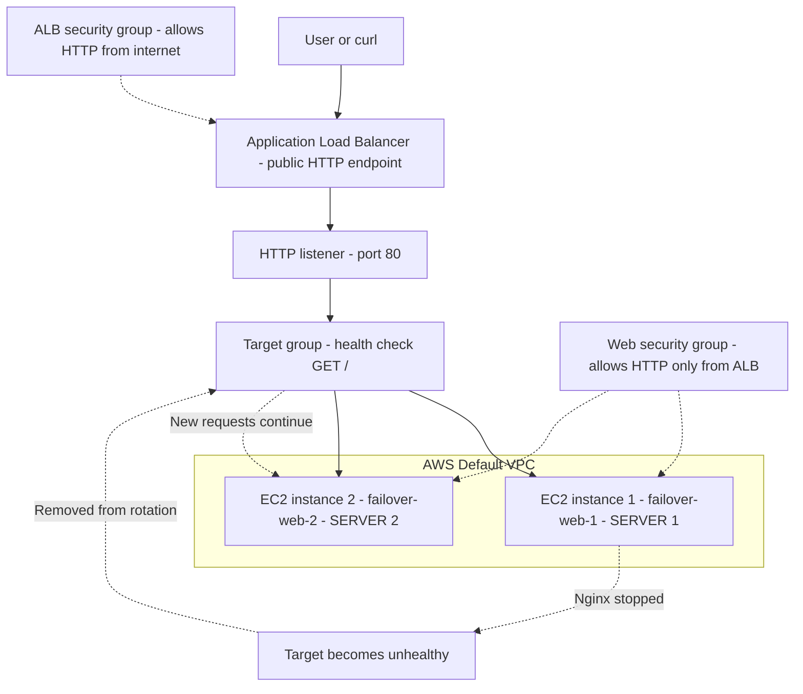

# AWS ALB failover demo (Terraform)

Demonstrates **traffic failover**, not automatic EC2 replacement. Uses two Amazon Linux 2023 EC2 instances with nginx and an internet-facing Application Load Balancer. The ALB security group allows HTTP from the internet; instance HTTP access is allowed **only from the ALB**. Demo uses HTTP only and default VPC for simplicity; do not copy as production architecture.

## Learn with DevOps Engineer

- Book a 1:1 session on [Topmate](https://topmate.io/learnwithdevopsengineer)
- Join the [Learn with DevOps Engineer cohort](https://labs.learnwithdevopsengineer.com/cohort/)

## Architecture




The key idea is simple: the ALB does not replace the failed EC2 instance. It detects that the instance is unhealthy and sends new requests to the remaining healthy target.


## Prerequisites
- AWS account and CLI credentials configured; Terraform >= 1.5
- Your public IP in CIDR form for SSH access, for example `203.0.113.10/32`
- AWS default VPC with at least two suitable subnets in different AZs (typically default VPC subnets)
- Permissions to manage EC2, ALB, security groups and related resources
- AWS charges apply, particularly for the ALB. Clean up promptly.

## Deploy

```bash
aws login
MY_IP=$(curl -s https://checkip.amazonaws.com)
eval "$(aws configure export-credentials --format env)"
terraform init
terraform fmt -check
terraform validate
terraform plan \
  -out=tfplan \
  -var="ssh_allowed_cidr=${MY_IP}/32"
terraform apply tfplan
terraform output -raw website_url
```

## Run the failover experiment

Get the current ALB URL and secure the generated private key:

```bash
ALB_URL="$(terraform output -raw website_url)"
chmod 600 ./failover-demo.pem
```

Check that both servers respond through the ALB:

```bash
for i in $(seq 1 12); do
  curl -s "$ALB_URL" | grep -o 'SERVER [12]' | head -1
done
```

Connect to server 1 and stop nginx:

```bash
PUBLIC_IP="$(terraform output -json public_ips | jq -r '.[0]')"
ssh -i ./failover-demo.pem ec2-user@"$PUBLIC_IP"
sudo systemctl status nginx
sudo systemctl stop nginx
sudo systemctl status nginx
exit
```

Wait for the ALB health check to mark server 1 unhealthy, then run the request loop again. Successful requests should now come from server 2:

```bash
for i in $(seq 1 12); do
  curl -s "$ALB_URL" | grep -o 'SERVER [12]' | head -1
done
```

To restore server 1:

```bash
ssh -i ./failover-demo.pem ec2-user@"$PUBLIC_IP"
sudo systemctl start nginx
exit
```

Deployment-specific account IDs, instance IDs, public IPs, and load-balancer hostnames are intentionally not stored in this repository. Use Terraform outputs to retrieve current values.

## Clean up

Use the same SSH CIDR variable during destroy:

```bash
MY_IP=$(curl -s https://checkip.amazonaws.com)
eval "$(aws configure export-credentials --format env)"
terraform destroy \
  -var="ssh_allowed_cidr=${MY_IP}/32"
```

Type `yes` when Terraform asks for confirmation.
